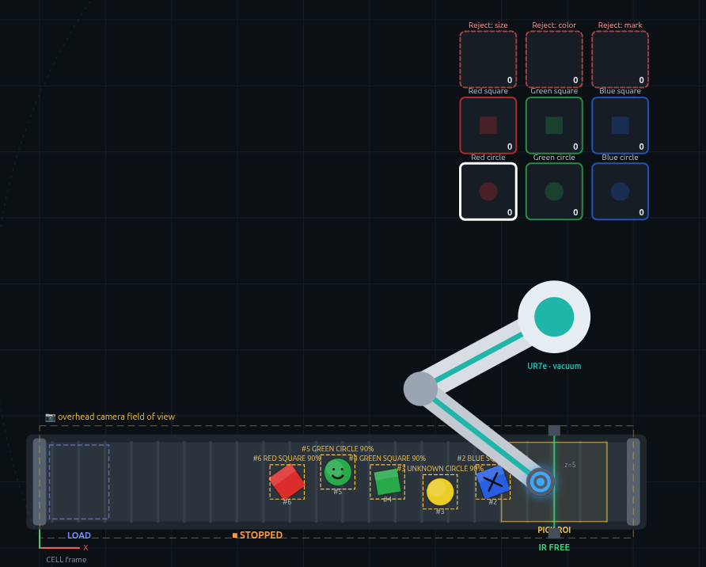
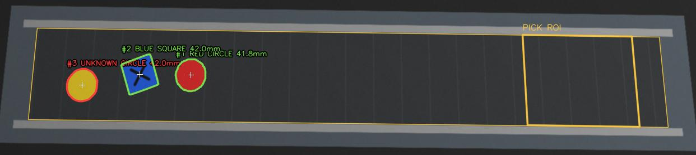

# Quality Inspection Cell — ROS 2 Capstone (simulation)

A complete, documented ROS 2 (Jazzy) system for a **quality inspection cell**:

* a **conveyor** where an operator places pieces by hand,
* an **IR sensor** at the end of the conveyor (purely reactive),
* an **overhead camera** that sees the whole belt and inspects the piece in a pick-zone ROI,
* a **Universal Robots UR7e** with a **vacuum suction cup** that picks the piece and drops it into one of **9 bins**,
* an **Arduino** that drives the conveyor motor and reads the IR sensor,
* a **supervisor** that is the only node that sends commands, based on explicit rules.

Everything runs in simulation. The camera runs the **real OpenCV vision pipeline** on
images rendered from the simulator (or on a USB camera). The **real drivers** (Arduino bridge + firmware, UR7e
node) are included with the same topics. A **web dashboard** shows the cell live. From the
dashboard you can place pieces on the belt and see the architecture as a live
`rqt_graph`.

```
 operator ──► [ conveyor ]──────────────────────[IR]──┐
                 ▲   overhead camera sees the belt     │  piece stops here,
                 │   (preliminary detections)          │  camera does the final inspection
                 │                                     ▼
            supervisor ◄── status ── devices      robot picks it ──► 1 of 9 bins
                 └────── commands ──►
```

---

## Screenshots

| Cell view (simulated) | What the camera sees (OpenCV pipeline) |
|---|---|
|  |  |

## Quick start

```bash
git clone <this repository> quality_inspection_cell
cd quality_inspection_cell
./build.sh          # builds ros2_ws (cell_interfaces + quality_cell)
./run.sh            # launches all nodes and opens http://localhost:8080
./test.sh           # 199 tests (rules, classifier, robot plan, vision pipeline)
```

Other modes:

```bash
./run.sh robot:=ur7e_dry                      # simulation + REAL UR7e driver code, no robot
./run.sh camera_backend:=sim                  # ground-truth camera instead of the OpenCV pipeline (light CPU)
./run.sh robot:=ur7e ur_ip:=192.168.1.102     # real UR7e picks VIRTUAL pieces (hardware-in-the-loop)
ros2 launch quality_cell cell_real.launch.py port:=/dev/ttyACM0 ur_ip:=192.168.1.102   # real cell
```

Then, on the **Cell view** tab, pick a shape, color, size and mark and click
**Place on belt** (or use **Batch of 6**). Watch the conveyor start, the camera detect
the piece, the IR sensor stop the belt, the final inspection, and the robot
put the piece in its bin.

Requirements: Ubuntu 24.04 + ROS 2 Jazzy (`/opt/ros/jazzy`), `python3-yaml`,
`colcon`. No extra Python packages and no internet are needed (the dashboard has no
external dependencies).

---

## Folder layout

```
quality_inspection_cell/
├── README.md                ← you are here
├── build.sh / run.sh / test.sh
├── docs/                    ← FULL DOCUMENTATION (read in order)
│   ├── 01_system_overview.md
│   ├── 02_architecture.md
│   ├── 03_state_machines.md
│   ├── 04_supervisor_rules.md
│   ├── 05_inspection_and_classification.md
│   ├── 06_simulation_and_dashboard.md
│   ├── 07_installation_and_running.md
│   ├── 08_moving_to_real_hardware.md
│   ├── 09_student_exercises.md
│   ├── 10_troubleshooting.md
│   ├── 11_design_decisions.md
│   ├── 12_ros2_cheatsheet.md
│   ├── 13_hardware_arduino_ur7e.md   ← wiring, Arduino protocol, UR7e setup, bring-up
│   ├── 14_camera_vision.md           ← OpenCV pipeline, camera setup, calibration, tuning
│   └── 15_physical_build_guide.md    ← BUILD THE REAL CELL: parts, layout, wiring, config, checklist
├── arduino/cell_io/cell_io.ino      ← Arduino firmware (conveyor motor + IR sensor)
├── tools/
│   ├── fake_arduino.py              ← virtual Arduino to test the bridge without hardware
│   ├── calibrate_robot_base.py      ← UR base ↔ cell frame calibration
│   ├── calibrate_camera.py          ← camera image ↔ belt (mm) calibration
│   └── make_build_figures.py        ← layout + wiring figures from cell_config.yaml
└── ros2_ws/src/
    ├── cell_interfaces/     ← custom messages (the "contract" between nodes)
    │   └── msg/*.msg
    └── quality_cell/        ← nodes, logic, config, launch, dashboard, tests
        ├── config/cell_config.yaml       ← ALL geometry / speeds / tolerances / bins
        ├── launch/cell_sim.launch.py     ← simulated cell
        ├── launch/cell_real.launch.py    ← template for the real cell
        ├── quality_cell/core/            ← pure Python logic (no ROS) – easy to test
        │   ├── supervisor_rules.py       ← THE RULES (R1–R11)
        │   ├── classifier.py             ← color / size / mark → verdict + bin
        │   ├── vision.py                 ← REAL OpenCV pipeline (detect, measure, marks, pose)
        │   ├── sim_renderer.py           ← synthetic camera images from the simulator
        │   ├── perception.py             ← ground-truth camera (backend "sim")
        │   ├── robot_plan.py             ← pick & place steps (shared sim / real robot)
        │   ├── cell_config.py, geometry.py
        ├── quality_cell/nodes/           ← one file per ROS 2 node
        │   ├── supervisor_node.py
        │   ├── conveyor_node.py
        │   ├── ir_sensor_node.py
        │   ├── camera_node.py
        │   ├── robot_node.py
        │   ├── world_sim_node.py         ← simulation only (physics)
        │   ├── dashboard_node.py         ← web server + monitor
        │   ├── arduino_io_node.py        ← REAL: Arduino → /conveyor + /ir_sensor
        │   └── ur7e_robot_node.py        ← REAL: UR7e (ur_rtde) + vacuum
        ├── quality_cell/web/             ← dashboard (HTML/CSS/JS)
        └── test/                         ← pytest unit tests
```

## Nodes and topics at a glance

| Node | Role | Publishes | Subscribes |
|---|---|---|---|
| `supervisor` | **Brain.** Only node that sends commands | `/conveyor/command`, `/camera/command`, `/robot/command`, `/supervisor/status` | `/ir_sensor/status`, `/conveyor/status`, `/camera/detections`, `/camera/inspection_result`, `/robot/status` |
| `conveyor` | Executes RUN/STOP (real: Arduino relay) | `/conveyor/status` | `/conveyor/command` |
| `ir_sensor` | **Reactive** – reports only, **no command topic** (real: Arduino input) | `/ir_sensor/status` | (sim: `/sim/world_state`) |
| `camera` | OpenCV pipeline: detections while moving + final inspection | `/camera/detections`, `/camera/inspection_result` | `/camera/command` (sim: `/sim/world_state`) |
| `robot` | UR7e pick & place state machine (vacuum) | `/robot/status` | `/robot/command` |
| `world_sim` | **Simulation only:** physics / ground truth | `/sim/world_state`, `/sim/events` | `/sim/spawn_piece`, `/sim/reset`, `/conveyor/status`, `/robot/status` |
| `cell_dashboard` | Web UI, operator, monitor | `/sim/spawn_piece`, `/sim/reset` | everything (read only) |

Start reading with [docs/01_system_overview.md](docs/01_system_overview.md).

**Building the real cell?** Follow [docs/15_physical_build_guide.md](docs/15_physical_build_guide.md):
bill of materials, layout with dimensions, wiring, measuring the cell, calibration and a
step-by-step commissioning checklist.
