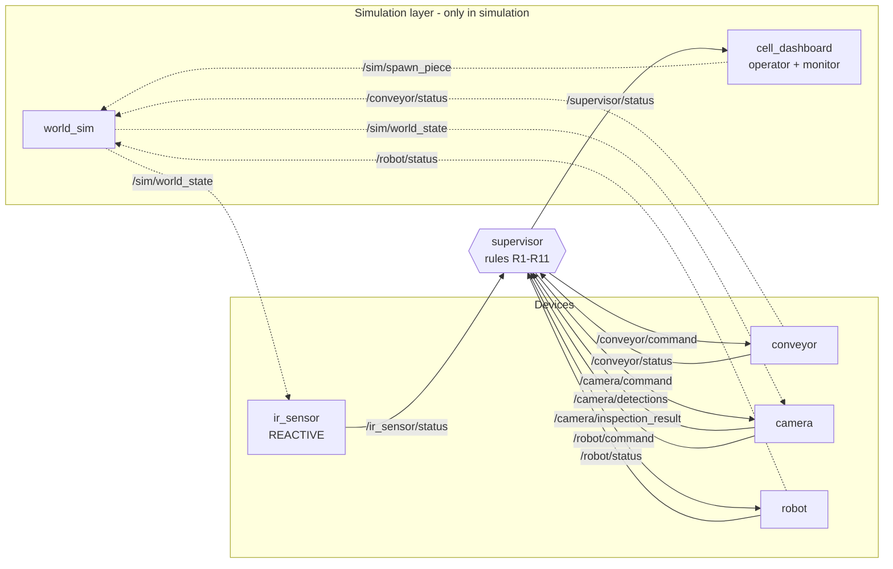

# 2. Architecture

## 2.1 ROS 2 graph

The dashboard has a tab **Architecture (rqt_graph)** that draws this graph *live* from the
running system (it uses the same introspection as `rqt_graph`). This is the static version:



Solid arrows = the real cell contract. Dotted arrows = simulation only.

## 2.2 Topics (the contract)

| Topic | Type (`cell_interfaces/msg/…`) | Publisher → Subscriber(s) | Rate |
|---|---|---|---|
| `/conveyor/command` | `ConveyorCommand` | supervisor → conveyor | on demand |
| `/conveyor/status` | `ConveyorStatus` | conveyor → supervisor (+ world_sim) | 10 Hz + on change |
| `/ir_sensor/status` | `IRSensorStatus` | ir_sensor → supervisor | 20 Hz + on change |
| `/camera/command` | `CameraCommand` | supervisor → camera | on demand |
| `/camera/detections` | `CameraDetections` | camera → supervisor | 10 Hz |
| `/camera/inspection_result` | `InspectionResult` | camera → supervisor | once per INSPECT |
| `/robot/command` | `RobotCommand` | supervisor → robot | on demand |
| `/robot/status` | `RobotStatus` | robot → supervisor (+ world_sim) | 20 Hz + on change |
| `/supervisor/status` | `SupervisorStatus` | supervisor → dashboard / logging | 5 Hz |
| `/camera/debug_image` | `sensor_msgs/CompressedImage` | camera → dashboard (JPEG with overlays, opencv backend) | 5 Hz |
| `/sim/world_state` | `SimWorldState` | world_sim → ir_sensor, camera (`sim` backend or `sim_render` source) | 50 Hz (**sim**) |
| `/sim/spawn_piece` | `SpawnPiece` | dashboard → world_sim | on demand (**sim**) |
| `/sim/reset` | `std_msgs/Empty` | dashboard → world_sim | on demand (**sim**) |
| `/sim/events` | `std_msgs/String` | world_sim → dashboard | on event (**sim**) |

> **There is no `/ir_sensor/command`.** This is deliberate: the sensor is reactive.

## 2.3 Messages

All message definitions are in `ros2_ws/src/cell_interfaces/msg/` and are commented
field by field. Every message has a `std_msgs/Header` (time stamp). String constants are
defined inside the messages, e.g. `ConveyorCommand.RUN`, `RobotStatus.PICKING_DONE`.

| Message | Main fields |
|---|---|
| `ConveyorCommand` | `command` (RUN/STOP), `reason` (rule id) |
| `ConveyorStatus` | `state` (RUNNING/STOPPED), `speed_mm_s`, `last_command` |
| `IRSensorStatus` | `state` (FREE/OCCUPIED), `changed` (true on transitions) |
| `CameraCommand` | `command` (INSPECT/CANCEL), `request_id`, `reason` |
| `DetectedPiece` | `track_id`, `shape`, `color`, `x_mm`, `y_mm`, `confidence` |
| `CameraDetections` | `pieces[]` (transport zone), `pick_zone_occupied`, `belt_motion_detected`, `camera_state` |
| `InspectionResult` | `request_id`, `success`, `shape`, `color`, `measured_size_mm`, `mark_detected`, `mark_type`, `verdict`, `defect`, `destination_bin`, `pick_x/y/z_mm`, `pick_yaw_deg`, `pose_confidence` |
| `RobotCommand` | `command` (PREPARE_PICK/PICK_AND_PLACE/GO_HOME/RESET), `job_id`, `pick_*`, `destination_bin` |
| `RobotStatus` | `state`, `job_id`, `target_bin`, `vacuum_on`, `tcp_*`, `detail` |
| `SupervisorStatus` | `cell_state`, `last_rule`, `last_command`, `active_rules[]`, counters |
| `SimPiece` / `SimWorldState` / `SpawnPiece` | simulation ground truth & spawning |

Show any of them from a terminal:

```bash
ros2 interface show cell_interfaces/msg/InspectionResult
```

### Why `request_id`?
The supervisor numbers each `INSPECT`. The camera echoes the number back. The supervisor
ignores any result whose id does not match the request it is waiting for (stale answer
after a retry). Same idea with `job_id` for the robot.

## 2.4 Coordinate frames

```
            +Y (towards the robot)
             ^
             |        bins (3 x 3)
             |         robot base  (780, 250)
             |
  origin ----+=====================[IR x=780]==|---> +X  (belt travel)
 (belt start,          belt 900 x 120 mm
  centre line,
  belt surface)
```

* **CELL frame** (`cell`): origin at the start of the belt on its centre line, on the belt
  surface; X along the travel direction; Y to the left; Z up. All geometry in
  `cell_config.yaml` is in this frame. The camera works in this frame.
* **ROBOT BASE frame** (`robot_base`): the robot's own frame. Its pose in the cell frame is
  `camera.robot_base_in_cell` in the config (in the real cell: from calibration).
* The camera **converts the pick pose to the robot base frame** before sending it
  (`InspectionResult.pick_*`). The robot also gets bin positions converted to its frame.
  Code: `quality_cell/core/cell_config.py::FrameTransform`.

## 2.5 Code organisation: logic vs. ROS plumbing

```
quality_cell/core/    ← pure Python, NO ROS: rules, classifier, perception, geometry
quality_cell/nodes/   ← thin ROS 2 wrappers: subscribe → call core → publish
```

This separation lets students test the logic with `pytest` without starting ROS and makes
the "what" (rules) easy to find and modify independently of the "how" (topics).

## 2.6 Configuration

A single file, `ros2_ws/src/quality_cell/config/cell_config.yaml`, holds geometry, speeds,
sensor rates, camera ROI, noise, size tolerance, color hue windows, defect priority, the
9 bins and robot parameters. Every node receives its path via the ROS parameter
`cell_config_file` (set by the launch file). Use another file with:

```bash
ros2 launch quality_cell cell_sim.launch.py config:=/abs/path/my_config.yaml
```

Because the workspace is built with `--symlink-install`, editing the YAML (or the Python
code) only needs a relaunch, not a rebuild.

Continue with [03_state_machines.md](03_state_machines.md).
