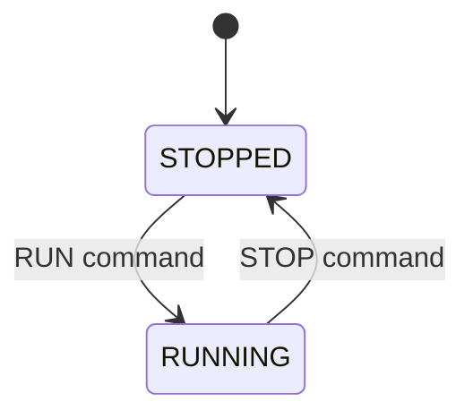
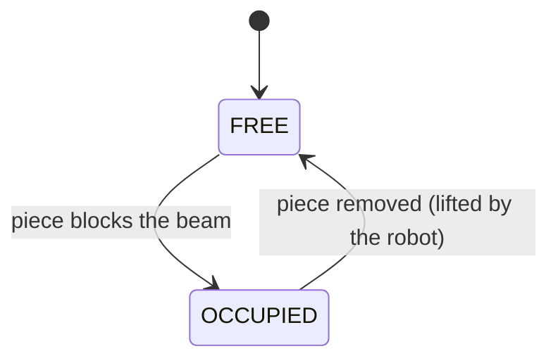
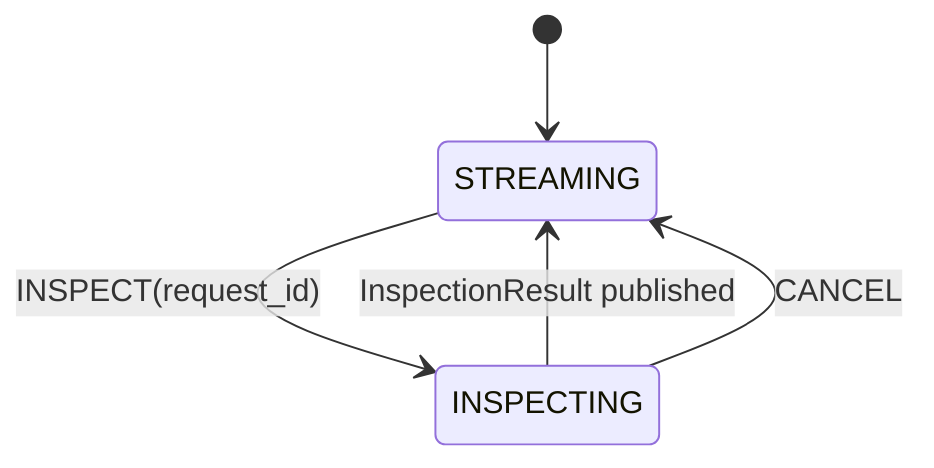
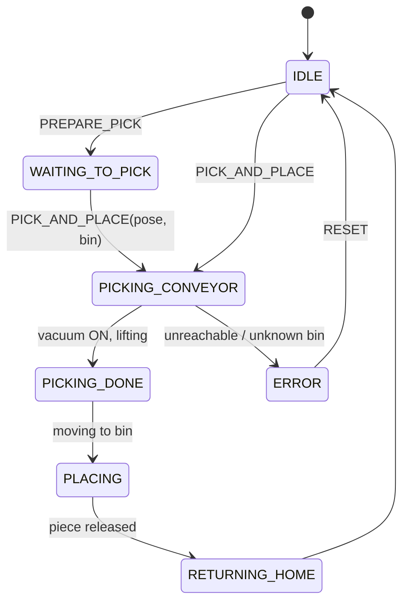
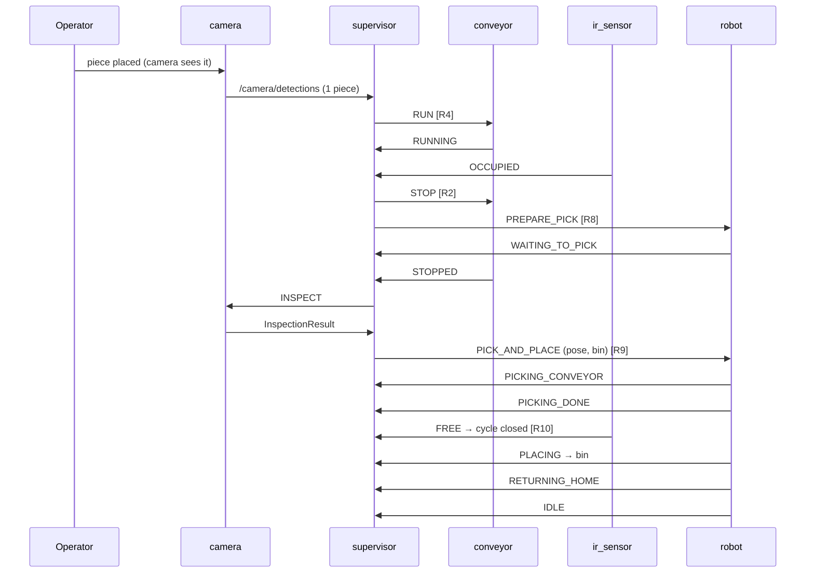

# 3. State machines

All states are published on the device's `status` topic and shown live on the dashboard
(**Supervisor rules & state machines** tab, and the robot strip under the cell view).

## 3.1 Conveyor — `/conveyor/status`

The conveyor has **no logic**. The supervisor decides:

| Situation | Conveyor must be |
|---|---|
| IR sensor OCCUPIED | **STOPPED — always, no exception** |
| IR sensor unknown / silent | STOPPED (fail-safe) |
| Robot picking on the belt | STOPPED |
| IR FREE and at least one piece on the belt | RUNNING |
| IR FREE and no piece in the cell | STOPPED |

## 3.2 IR sensor — `/ir_sensor/status`

* **Reactive**: no command topic; nobody tells it what to do.
* Publishes at 20 Hz **and** immediately on every transition (`changed = true`).
* The periodic message is a heartbeat: if the supervisor stops receiving it for
  `sensor_timeout_s` (1 s) it stops the belt (rule R1).

## 3.3 Camera — `/camera/detections` (`camera_state`)

* **STREAMING**: 10 Hz detections of pieces in the **transport zone** (outside the pick ROI):
  track id, shape, color, position, confidence. Also reports `pick_zone_occupied` and a
  camera-based estimate of belt motion.
* **INSPECTING**: final inspection of the piece in the **pick ROI** (takes
  `inspection_time_s`), then one `InspectionResult`.

## 3.4 Robot — `/robot/status`

| State | What the robot does |
|---|---|
| `IDLE` | At home, nothing to do |
| `WAITING_TO_PICK` | A piece is at the IR sensor; waiting for the camera result (pick pose + bin) |
| `PICKING_CONVEYOR` | Approach above the piece, descend until the cup touches it, vacuum ON, wait `vacuum_on_time_s` |
| `PICKING_DONE` | Piece grasped, lifting it from the belt (the IR beam becomes FREE here) |
| `PLACING` | Move to the destination bin (`target_bin`), descend, vacuum OFF, wait `vacuum_off_time_s`, retreat |
| `RETURNING_HOME` | Back to the home pose |
| `ERROR` | Target out of reach or unknown bin; needs `RESET` |

`RobotStatus.vacuum_on` tells whether the suction is active. The step list is shared by the
simulated and the real robot: `quality_cell/core/robot_plan.py`.

`RobotStatus.target_bin` tells which bin is being served (e.g. `PLACING → BIN_RED_CIRCLE`).

## 3.5 Supervisor — `/supervisor/status` (`cell_state`)

High-level label computed from the supervisor's view (for humans, not used by rules):

| cell_state | Meaning |
|---|---|
| `WAITING_FOR_SENSORS` | No IR message received yet |
| `IDLE` | Nothing in the cell |
| `TRANSPORTING` | Belt running |
| `INSPECTING` | Piece at the IR sensor, waiting for the inspection |
| `WAITING_ROBOT` | Inspection done, robot still busy with the previous piece |
| `ROBOT_PICKING` | Robot picking from the belt |
| `ROBOT_PLACING` | Robot placing / returning, belt stopped |
| `FAULT_INSPECTION` | Camera did not answer after the retries |
| `FAULT_ROBOT` | Robot in ERROR |

## 3.6 Sequence diagram of one piece

Continue with [04_supervisor_rules.md](04_supervisor_rules.md).
