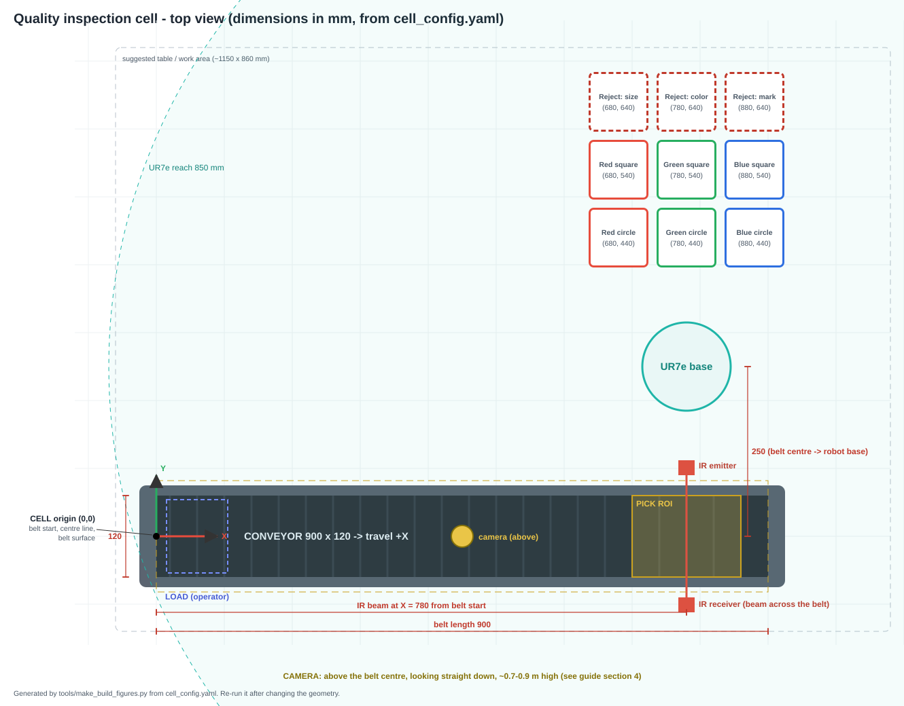
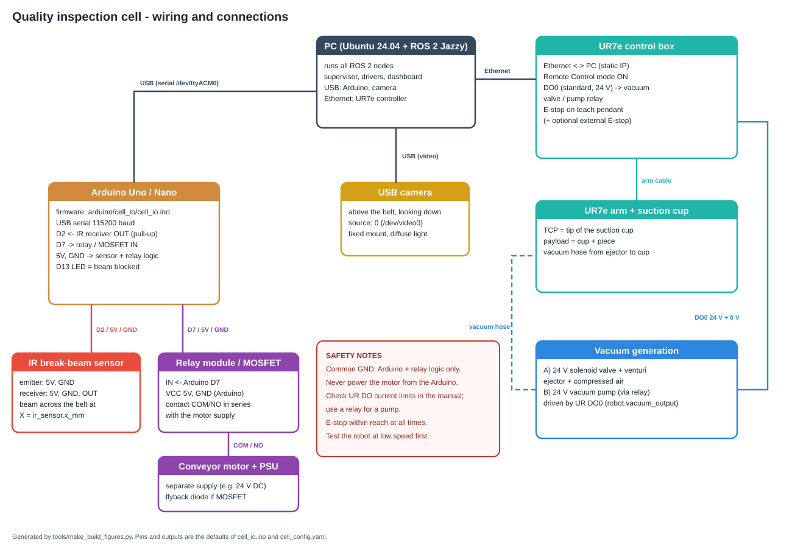

# 15. Physical build guide (from empty table to a working cell)

This guide is the **end-to-end procedure** to build the real cell. It collects in one place
what is needed, how to place it, how to wire it, how to transfer the real measurements to
`cell_config.yaml`, how to calibrate, and how to commission the cell step by step.

Deeper details live in the specialised chapters and are linked from each section:
[13 – Arduino and UR7e](13_hardware_arduino_ur7e.md) · [14 – Camera and vision](14_camera_vision.md) ·
[08 – Moving to real hardware](08_moving_to_real_hardware.md).

**Golden rule: never skip a phase.** Each phase is tested on its own before the next one is
added. The simulation (`./run.sh`) must work on the lab PC before touching any hardware.

| Phase | What | Section |
|---|---|---|
| 0 | Safety rules for the whole build | [1](#1-safety-first) |
| 1 | Get the parts | [2](#2-bill-of-materials) |
| 2 | Place everything on the table | [3](#3-layout-and-dimensions), [4](#4-mechanical-build) |
| 3 | Wire and plumb | [5](#5-electrical-wiring), [6](#6-vacuum-pneumatics) |
| 4 | Install the software on the lab PC | [7](#7-software-on-the-lab-pc) |
| 5 | Measure the cell and write the config | [8](#8-measure-the-cell-and-fill-the-config) |
| 6 | Calibrate robot and camera | [9](#9-calibration) |
| 7 | Commission device by device, then the whole cell | [10](#10-commissioning-checklist) |
| 8 | Daily operation | [11](#11-daily-start-and-stop-procedure) |

---

## 1. Safety first

The UR7e is a collaborative robot, but a cell with a robot, a moving belt, compressed air and
mains-powered supplies is still a machine. Before the first power-up the instructor should do
a short **risk assessment** of the cell.

* **Emergency stop** reachable from the operator position at all times (teach-pendant e-stop;
  an additional external e-stop wired to the UR safety inputs is recommended).
* **Safety configuration of the UR7e** (PolyScope → Safety): reduced joint/TCP speed and force
  limits while testing; **safety planes** so the robot cannot reach the operator side of the
  table or go below the belt/bin surfaces.
* **First motions always at low speed** (`robot.tcp_speed_mm_s: 100` or less) and with a hand
  on the e-stop. Use `robot:=ur7e_dry` and the hardware-in-the-loop mode before real pieces.
* **Remote mode = the PC can move the robot at any moment.** Nobody inside the robot reach
  while the robot is in Remote mode and the software is running.
* **Electrical**: the conveyor motor has its **own power supply**; never power it from the
  Arduino. Mains wiring only by qualified people, inside closed enclosures.
* **Pneumatics**: wear eye protection when connecting compressed air; depressurise before
  disconnecting hoses.
* **Hardware interlock**: keep `HW_INTERLOCK = true` in the Arduino firmware (the belt stops
  by itself when the IR beam is blocked, even if the PC hangs).

---

## 2. Bill of materials

Recommended specifications. Equivalent parts are fine; the column *config* says which
setting must change if your part is different.

| # | Item | Recommended spec | Qty | Notes | Config / code |
|---|---|---|---|---|---|
| 1 | Robot | Universal Robots **UR7e** + control box + teach pendant | 1 | 850 mm reach, 7.5 kg payload | `robot.*` |
| 2 | Suction cup | Flat or 1.5-bellows silicone cup, **Ø 20–30 mm**, with M5/G1/8 fitting | 1 (+1 spare) | Bellows absorb small height errors; Ø < piece size (42 mm) | `robot.pick_press_mm` |
| 3 | Vacuum generation | **A)** 24 V DC solenoid valve + venturi ejector (needs compressed air 4–6 bar) **or B)** 12/24 V mini vacuum pump + relay | 1 | Option A is faster and simpler to switch | `robot.vacuum_output` |
| 4 | Tool flange adapter | Plate/bracket to mount the cup on the UR flange (ISO 9409-1-50-4-M6) | 1 | Measure flange → cup-tip length for the TCP | pendant TCP |
| 5 | Hoses + fittings | 4–6 mm PU tube, push-in fittings | — | Route along the arm with clips | — |
| 6 | Conveyor | Small belt conveyor ≈ **900 × 120 mm** useful belt, **dark, matte** belt, DC motor (12/24 V) | 1 | Belt colour must contrast with the pieces | `conveyor.*` |
| 7 | Conveyor PSU | Supply matching the motor (e.g. 24 V DC, ≥ 2× motor current) | 1 | Separate from the Arduino | — |
| 8 | Microcontroller | **Arduino Uno / Nano** + USB cable | 1 | Firmware `arduino/cell_io/cell_io.ino` | `port` |
| 9 | Motor switch | 1-channel **relay module** (5 V coil) **or** logic-level MOSFET module + flyback diode | 1 | Many relay modules are active-LOW | `MOTOR_ACTIVE_HIGH` |
| 10 | IR sensor | **Through-beam (break-beam) IR pair**, 5 V, digital output | 1 | See the note on piece thickness in §4.2 | `IR_ACTIVE_LOW`, `ir_sensor.x_mm` |
| 11 | Camera | USB camera **1280×720** or better, manual focus/exposure if possible, low-distortion lens (HFOV 60–75°) | 1 | Avoid fisheye webcams | `camera.source`, `camera.capture` |
| 12 | Camera mount | Rigid arm / aluminium profile, **0.7–0.9 m** above the belt | 1 | Must not move after calibration | — |
| 13 | Lighting | Diffuse LED panel or 2 LED bars with diffusers | 1–2 | No direct spotlights (reflections = false marks) | `camera.vision.*` |
| 14 | Bins | 9 boxes ≈ **85 × 85 mm** opening, ≤ 60 mm high | 9 | Label them; reject bins in a different colour | `bins.*` |
| 15 | Pieces | Circles Ø 42 mm and squares 42 mm; red, green, blue + some defective ones | ~30 | Thickness ≥ 6 mm (≥ 10 mm makes the IR easier) | `pieces.*` |
| 16 | Lab PC | Ubuntu 24.04 + ROS 2 Jazzy, 2 USB ports, Ethernet | 1 | Static IP on the robot subnet | — |
| 17 | Network | Ethernet cable PC ↔ UR control box (or a switch) | 1 | — | `robot.ur_ip` |
| 18 | Calibration | Tape measure, caliper, 5 small round stickers (Ø 8–10 mm) for camera markers | — | — | — |
| 19 | Table | Rigid table ≈ 1.2 × 0.9 m | 1 | The robot base must be bolted down | — |

---

## 3. Layout and dimensions



The figure is drawn **from `cell_config.yaml`**, so it is exactly the layout the software
expects. If you change the geometry in the config, regenerate it:

```bash
python3 tools/make_build_figures.py
```

Key dimensions of the default configuration (CELL frame, mm — origin at the belt start, on
its centre line, on the belt surface; +X = belt travel; +Y = towards the robot):

| Element | Value | Config key |
|---|---|---|
| Belt useful length × width | 900 × 120 | `conveyor.length_mm`, `width_mm` |
| Load zone (operator drops pieces) | X ≈ 60 | `conveyor.spawn_x_mm` |
| IR beam (across the belt) | X = 780 | `ir_sensor.x_mm` |
| Pick ROI (final inspection) | X 700–860, whole width | `camera.pick_roi` |
| Belt end | X = 900 (≥ 100 mm after the IR beam) | — |
| UR7e base centre | (780, 250) — on the side of the belt, opposite the operator | `camera.robot_base_in_cell` |
| Bins (3 × 3 grid, 100 mm pitch) | X 680/780/880, Y 440/540/640 | `bins.list` |
| Camera | above the belt centre (X ≈ 450, Y = 0) | `camera.fov` |

**You do not have to copy these numbers.** Place the parts where it makes sense in your lab
and then write the *measured* values in the config (section 8). What matters:

* the IR beam at least ~100 mm before the end of the belt (the piece must stop on the belt);
* the pick ROI around the IR beam, fully on the belt;
* the pick point and **all** bins inside the robot reach (850 mm) and comfortably reachable
  with the cup pointing down (avoid the area right next to and right above the base);
* the operator side (load zone) away from the robot.

---

## 4. Mechanical build

### 4.1 Conveyor
1. Fix the conveyor to the table (clamps or bolts) so it cannot move — every coordinate
   depends on it.
2. Check the travel direction: the belt must move **from the load zone towards the IR
   sensor** when the motor is ON. If not, swap the motor wires (DC motor).
3. Mark the **cell origin** on the frame: belt start, on the belt centre line. All
   measurements start here (a small sticker or a scribed line).
4. Measure the real belt speed: time a piece over 500 mm → `conveyor.speed_mm_s`.

### 4.2 IR sensor (break-beam)
1. Mount emitter and receiver **facing each other across the belt** at `X = ir_sensor.x_mm`,
   on small brackets fixed to the conveyor frame (not to the table).
2. **Beam height**: the beam must be cut by the piece and **not** by the belt. With 6 mm thick
   pieces the beam has to be **≈ 3 mm above the belt surface** — small 3 mm / 5 mm break-beam
   sensors mounted at belt level work. If you cannot get the beam that low, make the pieces
   thicker (≥ 10 mm) and update `pieces.thickness_mm`.
3. Align: with the Arduino running, the on-board LED (D13) must be **off** with nothing on the
   belt and **on** when you put a piece in the beam.
4. Shield the receiver from direct sunlight / lamps (IR interference).

### 4.3 Robot and end effector
1. Bolt the UR7e base to the table (or a stand) at the planned position.
2. Mount the suction cup on the flange with the adapter plate; measure the **flange → cup tip**
   distance with a caliper (you need it for the TCP, §9.1).
3. Route the vacuum hose along the arm with clips, leaving slack at the wrist joints;
   move the robot by hand (freedrive) through its whole workspace to check the hose never
   pulls or snags.

### 4.4 Camera and lighting
1. Mount the camera **looking straight down** above the belt centre.
2. Height: the camera must see the whole belt (≈ 1000 mm with margins):

   ```
   height ≈ (field width / 2) / tan(HFOV / 2)
   HFOV 60° → 0.87 m      HFOV 70° → 0.71 m      HFOV 78° → 0.62 m
   ```

   Put the camera a little higher than computed, then check the image covers the whole belt
   (`camera.fov`) including the LOAD zone and the pick ROI.
3. The mount must be **rigid**: if the camera moves, the calibration is lost.
4. Lighting: diffuse, from above, uniform over the belt; turn off auto exposure / auto white
   balance if the camera allows it (`v4l2-ctl -d /dev/video0 --list-ctrls`).
5. Check the image with `cheese` or `guvcview`: no reflections on the pieces, no dark corners.

### 4.5 Bins
Place the 9 bins in a grid inside the robot reach (default: 3 × 3, 100 mm pitch). Fix them
(double-sided tape / a printed or wooden template). Label each one with its id
(`BIN_RED_CIRCLE`, …, `BIN_REJECT_MARKED`). Keep the reject bins visually different.

---

## 5. Electrical wiring



### 5.1 Arduino ↔ sensors and motor (default pins of `cell_io.ino`)

| From | To | Wire | Notes |
|---|---|---|---|
| Arduino **5V** | IR emitter VCC, IR receiver VCC, relay module VCC | red | |
| Arduino **GND** | IR emitter GND, IR receiver GND, relay module GND | black | common logic ground |
| IR receiver **OUT** | Arduino **D2** | yellow | `INPUT_PULLUP` in the firmware |
| Arduino **D7** | relay module **IN** | blue | |
| Relay **COM / NO** | in series with the motor **+** supply | heavy gauge | motor PSU separate |
| Motor PSU **−** | motor **−** | heavy gauge | |
| Arduino USB | lab PC | USB cable | appears as `/dev/ttyACM0` |

Polarity settings at the top of `arduino/cell_io/cell_io.ino`:

| Your hardware | Setting |
|---|---|
| Receiver output goes LOW when the beam is blocked (most break-beams) | `IR_ACTIVE_LOW = true` |
| Receiver output goes HIGH when blocked | `IR_ACTIVE_LOW = false` |
| Relay module switches ON with IN = HIGH | `MOTOR_ACTIVE_HIGH = true` |
| Relay module switches ON with IN = LOW (very common, opto-isolated modules) | `MOTOR_ACTIVE_HIGH = false` |

With a **MOSFET** instead of a relay: logic-level N-MOSFET on the low side, **flyback diode**
across the motor, and a 10 kΩ pull-down on the gate.

### 5.2 Robot, camera and network

| Connection | Details |
|---|---|
| PC ↔ UR7e control box | Ethernet. Static IPs on the same subnet (e.g. robot `192.168.1.102`, PC `192.168.1.100/24`) → `robot.ur_ip` |
| UR control box DO0 → vacuum | 24 V digital output → solenoid valve (option A) or pump relay (option B). Check the output current rating in the UR7e manual; use a relay for anything above it. Other output → `robot.vacuum_output` |
| Camera → PC | USB, preferably a USB 3 port, short cable |
| E-stop | Teach pendant; optional external e-stop to the UR safety inputs (configure in PolyScope Safety) |

---

## 6. Vacuum (pneumatics)

**Option A – ejector (recommended):**
`compressed air (4–6 bar) → regulator → 24 V solenoid valve (driven by UR DO0) → venturi
ejector → hose → suction cup`. Vacuum ON = valve open.

**Option B – pump:** `24 V relay (driven by UR DO0) → vacuum pump → hose → suction cup`.
Slower to build up and release vacuum: increase `robot.vacuum_on_time_s` and
`vacuum_off_time_s`.

Test before connecting to the software: on the teach pendant (I/O tab) toggle DO0 by hand and
check that a piece is held firmly and drops cleanly when released. If the piece sticks when
the vacuum is OFF, increase `vacuum_off_time_s` (or add a blow-off valve).

---

## 7. Software on the lab PC

```bash
# 1. ROS 2 Jazzy (if not installed) - https://docs.ros.org/en/jazzy/Installation.html
sudo apt install python3-colcon-common-extensions python3-opencv python3-serial

# 2. The project
git clone https://github.com/juanlopez-gif/quality-inspection-cell.git
cd quality-inspection-cell
./build.sh && ./test.sh          # 200 tests must pass
./run.sh                         # the SIMULATION must work before any hardware

# 3. Access to the Arduino serial port (log out and in afterwards)
sudo usermod -aG dialout $USER

# 4. Library for the UR7e
pip3 install --user --break-system-packages ur_rtde
```

Flash the Arduino with the Arduino IDE: open `arduino/cell_io/cell_io.ino`, set the polarity
constants (§5.1), select the board and port, upload. Serial Monitor at 115200 baud must show
`BOOT quality_cell_io 1` and `STAT 0 0` lines.

---

## 8. Measure the cell and fill the config

All values go into `ros2_ws/src/quality_cell/config/cell_config.yaml` (millimetres, CELL frame).
Because the workspace is built with `--symlink-install`, saving the file and relaunching is
enough.

| What to measure | How | Config key |
|---|---|---|
| Useful belt length and width | tape measure | `conveyor.length_mm`, `width_mm` |
| Belt speed | time a piece over 500 mm: speed = 500 / t | `conveyor.speed_mm_s` |
| Where the operator drops pieces | X of the centre of the load zone | `conveyor.spawn_x_mm` |
| IR beam position | X of the beam from the belt start | `ir_sensor.x_mm` |
| Pick ROI | ~80 mm before to ~80 mm after the beam, whole belt width | `camera.pick_roi` |
| Camera field of view | part of the belt visible in the image | `camera.fov` |
| Piece thickness / nominal size / tolerance | caliper | `pieces.*` |
| Bin centres | tape measure from the cell origin (X along the belt, Y towards the robot) | `bins.list[].x`, `.y` |
| Release height above the bins | bin rim height above the belt surface + ~30 mm | `bins.drop_z_mm` |
| Robot base pose | calibration, §9.1 | `camera.robot_base_in_cell` |
| Robot home | jog to a safe pose above the belt, read X, Y, Z on the pendant (Base) | `robot.home_tcp` |
| Tool orientation (cup down) | read RX, RY, RZ on the pendant with the cup vertical | `robot.tool_rotvec` |
| Robot IP | pendant: Settings → System → Network | `robot.ur_ip` |
| Vacuum output | which DO drives the valve / pump | `robot.vacuum_output`, `vacuum_active_high` |
| Speeds for the first tests | low | `robot.tcp_speed_mm_s: 100` |

After editing, regenerate the layout figure (`python3 tools/make_build_figures.py`) and
compare it with the real table: it is a quick sanity check of the numbers.

---

## 9. Calibration

### 9.1 Robot ↔ cell (UR base pose)
1. On the pendant, set the **TCP** to the tip of the suction cup (Installation → General → TCP,
   Z = flange-to-cup-tip length) and the **payload**.
2. Stick 3–4 marks on the belt / table at known CELL coordinates (e.g. (200, 0), (700, 40),
   (700, −40)).
3. Freedrive the robot until the cup tip touches each mark; write down X, Y from the pendant
   (feature **Base**, mm).
4. Run `python3 tools/calibrate_robot_base.py points.txt` → copy the result to
   `camera.robot_base_in_cell`.
5. Touch the **belt surface** with the cup tip and read Z on the pendant: set `z = -Z`.

Details: [13 §13.2](13_hardware_arduino_ur7e.md#frames-and-calibration).

### 9.2 Camera ↔ belt (homography)
1. Stick 5 small markers on the belt at known CELL coordinates (corners of the FOV + centre).
2. `python3 tools/calibrate_camera.py --points markers.txt --source 0 --out camera_calibration.yaml`
   and click the markers in order. Error per marker must be **< 1 mm**; the rectified preview
   must show straight belt edges.
3. In the config: `camera.backend: opencv`, `source: 0`, `calibration_file: <absolute path>`,
   `capture` = the same resolution used for the calibration.

Details: [14 §14.3](14_camera_vision.md#143-setting-up-the-real-camera).

### 9.3 Size correction and colours
1. Put a good **42.0 mm** square (measured with a caliper) in the pick ROI, trigger an
   inspection (run the cell with `robot_dry_run:=true` and block the IR beam by hand), read the
   measured size in the dashboard. Same with a circle.
   `camera.vision.size_correction_mm: {CIRCLE: true − measured, SQUARE: true − measured}`.
2. Check that the colours are classified correctly under your light; if not, adjust the hue
   windows in `classification.colors` (see [14 §14.4](14_camera_vision.md#144-tuning-guide-cameravision)).

---

## 10. Commissioning checklist

Do the steps **in order**. Tick each box only when the expected result is observed. Keep the
e-stop at hand from step C onwards.

### A. Software (no hardware)
- [ ] `./test.sh` → 200 tests pass
- [ ] `./run.sh` → simulation sorts a *Batch of 6* correctly
- [ ] `./run.sh robot:=ur7e_dry` → same behaviour, log says `DRY RUN`

### B. Arduino, conveyor and IR
- [ ] Serial Monitor: `BOOT`, `STAT 0 0`; typing `RUN` starts the belt in the right direction, `STOP` stops it
- [ ] Blocking the beam: LED D13 on, `STAT 1 …`; with the belt running it **stops by itself** (firmware interlock)
- [ ] Unplugging the USB cable while running: the belt stops within 1.5 s (watchdog)
- [ ] `ros2 run quality_cell arduino_io_node --ros-args -p port:=/dev/ttyACM0` → `ros2 topic echo /ir_sensor/status` shows FREE / OCCUPIED correctly
- [ ] `ros2 topic pub --once /conveyor/command cell_interfaces/msg/ConveyorCommand "{command: RUN}"` runs the belt; `/conveyor/status` reports RUNNING

### C. Robot and vacuum
- [ ] Pendant: Remote Control enabled, robot in Remote mode, TCP and payload set, safety limits configured
- [ ] Vacuum by hand from the pendant I/O tab: piece held and released correctly
- [ ] `ros2 run quality_cell ur7e_robot_node --ros-args -p ur_ip:=<ip>` connects; `/robot/status` = IDLE
- [ ] `GO_HOME` command → robot goes to the home pose **slowly**
- [ ] One manual `PICK_AND_PLACE` (see [12](12_ros2_cheatsheet.md)) with a piece placed by hand at the pick point → correct height, vacuum ON/OFF, piece in the right bin
- [ ] Robot base calibration done (§9.1), residuals < 3 mm

### D. Robot hardware-in-the-loop (real robot, virtual pieces, empty belt)
- [ ] `./run.sh robot:=ur7e ur_ip:=<ip>` → the real robot picks the virtual pieces of a *Batch of 6* at the IR position and visits the right bins, without touching anything

### E. Camera
- [ ] Image covers the whole belt, sharp, no reflections
- [ ] Camera calibration done (§9.2), error < 1 mm
- [ ] `ros2 launch quality_cell cell_real.launch.py robot_dry_run:=true camera_source:=0 port:=/dev/ttyACM0` → in the dashboard "What the camera sees" every real piece has a contour, the right colour and shape, size within ±0.5 mm
- [ ] Marked pieces are detected as MARK; clean pieces are not
- [ ] Size correction and colour windows adjusted (§9.3)

### F. Full cell
- [ ] `ros2 launch quality_cell cell_real.launch.py port:=/dev/ttyACM0 ur_ip:=<ip> camera_source:=0`
- [ ] One good piece → belt runs, stops at the IR, inspection, pick, correct bin, belt stops when empty
- [ ] One piece of each defect (size, colour, mark) → correct reject bin
- [ ] Several pieces on the belt → the belt stops at every arrival at the IR and restarts after the pick
- [ ] Removing a piece by hand from the pick zone before the pick → rule R11 in the event log, next piece handled correctly
- [ ] E-stop during a pick → robot stops, `/robot/status` = ERROR; after recovery `RESET` works
- [ ] Only now increase `robot.tcp_speed_mm_s` step by step

---

## 11. Daily start and stop procedure

**Start**
1. Compressed air ON (option A) / pump power ON.
2. Conveyor PSU ON. Arduino connected (USB).
3. UR7e ON, brakes released, **Remote mode**.
4. Lights ON.
5. On the PC:
   ```bash
   cd ~/quality-inspection-cell
   ros2 launch quality_cell cell_real.launch.py port:=/dev/ttyACM0 ur_ip:=<ip> camera_source:=0
   ```
6. Open http://localhost:8080 and check every device card is online.

**Stop**
1. Wait until the cell is IDLE (no piece on the belt, robot at home).
2. Ctrl+C in the launch terminal (the Arduino stops the motor by itself).
3. Robot to Local mode / power off; air and PSUs OFF.

---

## 12. Typical problems during the build

| Problem | Likely cause | Fix |
|---|---|---|
| Belt runs backwards | motor wires swapped | swap the two motor wires |
| Belt runs when it should not / never runs | relay polarity | flip `MOTOR_ACTIVE_HIGH` and re-upload |
| IR always OCCUPIED or always FREE | sensor polarity or misalignment | flip `IR_ACTIVE_LOW`; realign; check D13 LED |
| IR triggered by the belt itself | beam too low / belt seam | raise the beam slightly; thicker pieces |
| Piece stops outside the pick ROI | IR position or ROI wrong, belt too fast | re-measure `ir_sensor.x_mm`, widen `pick_roi` |
| Robot picks a few mm off the piece | robot base calibration | redo §9.1; check the TCP length |
| Cup does not seal | cup too high or piece surface rough | increase `pick_press_mm` (1 → 2 mm); bellows cup |
| Piece falls during the move | weak vacuum / too fast | check air pressure / pump; longer `vacuum_on_time_s`; lower speed |
| Piece sticks to the cup in the bin | vacuum release too slow | longer `vacuum_off_time_s`; blow-off |
| Wrong sizes from the camera | calibration or correction missing | redo §9.2 and §9.3 |
| Clean pieces rejected as MARKED | reflections | diffuse the light; raise `mark_color_distance` |

More: [10 – Troubleshooting](10_troubleshooting.md).
